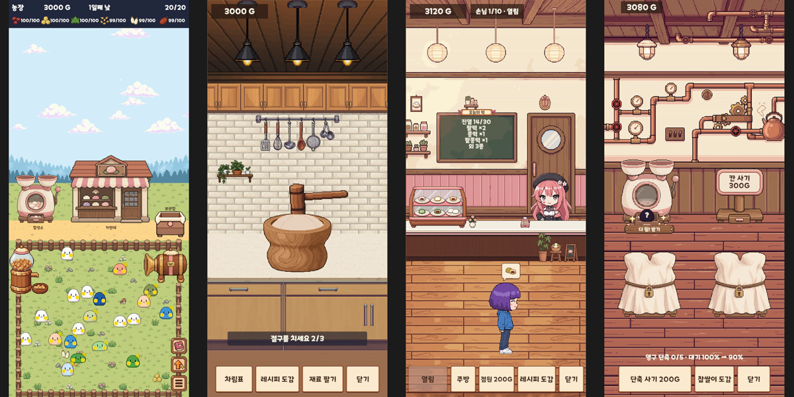

# 찹쌀이 떡집 (MozziProject)

**물려받은 농장에서 찹쌀이를 키우고, 둘씩 합쳐 새 종을 만들고, 그 재료로 찹쌀떡 레시피를 찾아 파는 2D 방치형 힐링 게임.**

인터넷 방송인 고차비 님의 **팬게임**입니다. 무료 · 비상업 · 그림은 전부 새로 그립니다.
모바일 세로 화면 기준이고 PC(Windows)와 안드로이드에서 돌아갑니다. 지금은 혼자 만드는 **프로토타입(v0.0.1)** 단계입니다. PC·안드로이드 빌드는 [Releases](https://github.com/MiruSona/MozziProject/releases) 에서 받습니다.



## 어떻게 노나

| 자리 | 하는 일 |
| --- | --- |
| 농장 | 찹쌀이들이 떡 재료를 떨어뜨립니다. 껐다 켜면 쌓여 있어서 주우면 됩니다 |
| 주방 | 재료 두 가지를 골라 믹서기에 갈고, 떡메로 치고, 빚어서 찝니다. 새 조합이면 새 레시피 |
| 가판대 | 손님 주문에 맞춰 떡을 팔아 골드를 법니다 |
| 합성소 | 골드로 찹쌀이 둘을 합쳐 새 종을 얻습니다 |

목표는 **찹쌀이 도감 24칸**과 **레시피 도감**을 채우는 것입니다. 전투 · 멀티 · 랭킹 · 과금은 없습니다.
소개 영상(1분)은 `Docs/History/영상/2026-10-18-소개.mp4` 에 있습니다.

## 만드는 환경

| 항목 | 값 |
| --- | --- |
| 엔진 | Unity 6 (6000.3.23f1) · 2D URP · C# |
| 그림 | 도트. PixelLab 으로 시안을 뽑아 고르고 다듬습니다 |
| 작업 방식 | Claude Code 와 같이 만듭니다. 기획 · 기록 · 기억 저장소가 모두 저장소 안에 있습니다 |

## 폴더 지도

| 폴더 | 무엇 |
| --- | --- |
| `ProjectMozziUnity/` | Unity 프로젝트 |
| `Docs/Design/` | 기획서 (컨셉 · 코어 루프 · 시스템 셋 · 수치표 · 아트 규칙) |
| `Docs/Research/` · `Docs/History/` | 조사 기록 · 반복(피드백 → 고치기) 기록과 영상 |
| `Docs/Reference/` | 참고 그림 · 정식 그림 원본 |
| `Memory/` | AI 기억 저장소 (`mem`). 결정 · 주의 · 기록이 쌓입니다 |
| `Tools/` | 직접 만든 개발 툴 열 개 (git 서브모듈). 아트 · 소리 · 공수 · 기억 · 기획 관문 등 |

## 받아서 열어 보려면

```
git clone --recurse-submodules https://github.com/MiruSona/MozziProject.git
git lfs install
git lfs pull
```

- 그림 · 소리 · 영상은 **Git LFS** 에 있습니다. `git lfs install` 을 안 하면 파일 대신 짧은 글자만 들어옵니다.
- 이미 받았는데 `Tools/` 가 비어 있으면 `git submodule update --init --recursive`.
- 글꼴(ONE 모바일 POP)은 재배포가 안 돼 저장소에 없습니다. 그대로도 돌아가고, 글꼴을 다시 구우려면 `Docs/Guide/개발환경.md` 의 글꼴 절을 봅니다.

## 더 읽기

- 이 게임이 무엇인지 : `Docs/Design/00-컨셉.md`
- 지금 어디까지 왔나 : `Docs/Todo/진행상황.md`
- 같이 일하는 규칙 : `AGENTS.md` (Claude Code 는 `CLAUDE.md` 도)

## 라이선스

찹쌀이 캐릭터와 고차비 관련 설정의 권리는 원작자와 소속사에 있습니다. 이 저장소의 코드 · 문서 · 그림은 팬 창작물이며 상업 이용을 하지 않습니다.
